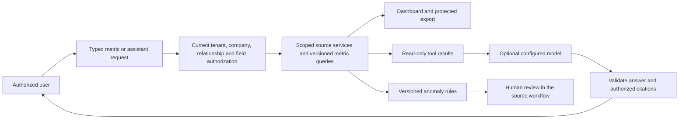

# Phase 6: Intelligence and scale

**Goal:** give authorized people reliable workforce and operating insight, help them find and explain approved information, and scale those reads without weakening the transactions that manage employment and pay.

**M1 through M5 have local implementation and qualification evidence.** Updated 3 November 2026 (Asia/Dhaka). The local candidate runs 6.5.0-local with schema 0073. Production qualification remains open. [M5 local qualification record](m5-scale-release-review.md)

Netro Systems Limited coordinates the work. Named product/data, security/privacy, operations and release owners still need assignment. M5 verified a new same-host development backup and removed one moderate dependency finding. Production backup ownership, the remaining dependency advisory and provider, host, country and independent-review gates carry forward from the [M7 dossier](m7-assurance-review.md). Design and isolated engineering can proceed; production activation retains those gates.

The handover identifies analytics, an AI assistant and anomaly detection as Phase 6's outline. The linked original product-plan artifact remains inaccessible through the research tool, so the milestone detail below is a repository-grounded proposal, not additional requirements attributed to that artifact. [ADR 031](../adr/031-intelligence-and-scale-boundaries.md) records the architectural decisions.

## Delivery sequence

| Milestone                              | Deliverable                                                                                                                                       | Dependencies                                                                | Status              |
| -------------------------------------- | ------------------------------------------------------------------------------------------------------------------------------------------------- | --------------------------------------------------------------------------- | ------------------- |
| **M1 Analytics foundations**           | Versioned metric definitions, current-authority query boundary and a bounded workforce dashboard with provenance and explicit missing-data states | M1 identity/field controls and M4 country/calendar foundations from Phase 5 | Implemented locally |
| **M2 Operating and financial insight** | Reconciled attendance/leave/learning and locked payroll trends, saved report definitions and protected export jobs                                | Phase 6 M1; source-module permissions and qualified country consumers       | Implemented locally |
| **M3 Read-only workspace assistant**   | Source-cited help and approved-metric explanations through a restricted tool registry; optional, explicitly configured model adapter              | M1/M2 contracts; provider/data/egress decisions before model activation     | Implemented locally |
| **M4 Explainable anomaly review**      | Versioned deterministic operational checks, contextual evidence, deduplication and human review/correction links                                  | M1/M2 facts; approved detection definitions                                 | Implemented locally |
| **M5 Scale and release qualification** | Measured query/job capacity, fair scheduling, operational recovery and rollout/rollback evidence on the supported hosting matrix                  | M1-M4; Phase 5 assurance and host qualification                             | Local checks passed |

**Phase exit:** scoped results reconcile to authoritative records; revocation and field denial apply to charts, caches, exports and assistant answers; every answer or alert exposes its source/version/period and limitations. Worker replay, source corrections and recovery preserve results. Measured service targets pass on the agreed deployment and dataset. The assistant performs no employment/payroll decisions or writes. Actual production activation requires the carried assurance, hosting, country and provider decisions.

## Existing seams to extend

| Existing implementation                                                                                                                                                                                                                               | Phase 6 consequence                                                                                                                                      |
| ----------------------------------------------------------------------------------------------------------------------------------------------------------------------------------------------------------------------------------------------------- | -------------------------------------------------------------------------------------------------------------------------------------------------------- |
| [Group dashboard](../../apps/api/src/modules/group/group-dashboard.service.ts) and [pure figures](../../apps/api/src/modules/group/figures.ts)                                                                                                        | Reuse and reconcile existing definitions before adding charts; validate history coverage rather than treating a fallback company as historical evidence. |
| [Employees and effective-dated job assignments](../../packages/db/src/schema/hr.ts), [separations](../../packages/db/src/schema/lifecycle.ts)                                                                                                         | Attribute facts to the company/job effective on the metric date. Current assignments alone cannot reconstruct history.                                   |
| [Payroll management reports](../../apps/api/src/modules/payroll/payroll-reports.service.ts)                                                                                                                                                           | Cost metrics come from locked run results and their country/currency context, with existing adjustment/bonus/settlement inclusion rules.                 |
| [Tenant database transactions](../../apps/api/src/db/db.module.ts), [permissions](../../packages/shared/src/permissions.ts), [policy evaluation](../../packages/shared/src/identity.ts) and [field access](../../apps/api/src/common/field-access.ts) | Tenant RLS is necessary; service-side company, relationship, source-permission and derived-field checks remain mandatory.                                |
| [Engagement results](../../apps/api/src/modules/engagement/engagement.service.ts) and [survey suppression](../../packages/shared/src/employee-services.ts)                                                                                            | Closed-result protection and minimum cohort of five remain intact. Phase 6 never receives raw anonymous responses or creates identifying drill-downs.    |
| [Fenced scheduled workers](../../apps/api/src/jobs/scheduled-worker.ts)                                                                                                                                                                               | Reuse durable ownership, retries and tenant context. The webhook delivery ledger is not a complete internal change stream or analytics source of truth.  |
| [Enterprise operator contract](../../infra/enterprise/README.md)                                                                                                                                                                                      | Same codebase and supported Postgres/Redis topology; offline operation requires no new vendor callback or silent cloud AI dependency.                    |

## Architecture and authority

Keep the NestJS modular monolith, PostgreSQL 17 and existing worker process. Start with bounded indexed queries against authoritative tables. Add rebuildable tenant fact/projection tables only when correctness and query plans justify them. Do not introduce a warehouse, new queue, vector database or service split solely for this phase.

The diagram shows proposed boundaries, not running services. Authorization also precedes retrieval/cache lookup and is rechecked before returning an asynchronous result or artifact. No raw SQL, database credential or owner-role connection reaches a model. The assistant cannot route around the same query boundary used by the dashboard.

1. Resolve the current session, user status, authorization revision, tenant access/feature/license state and bounded grants. Requested company IDs only narrow authority; they never establish it. Company A's data permission cannot borrow an analytics permission granted only for B. Explicit denial wins.
2. Apply employee relationships and source-field requirements before aggregation. Derived salary totals, differences and narratives require pay access even when their JSON names evade the existing field-name projector. An empty authorized dataset is different from denied, incomplete or suppressed data.
3. Historical facts use the company effective at the fact date, under the requester's current grant for that company. A former manager relationship gives no current access. A historical company-A aggregate must not join in company-B current details; a source-detail link can remain unavailable after a transfer.
4. Tenant users, platform operators, support, machine clients, kiosks and the assistant remain distinct principals. No new Phase 6 rights accrue to support or clients by default. Machine/API scopes and webhook event expansion require a separately versioned public contract.
5. New tenant tables receive FORCE RLS, composite tenant/company/source references and appropriate field encryption. Workers use tenant context under the application role; a platform migration/backup role never runs an online metric query. The platform-only M7 tables remain outside tenant RLS_TABLES.
6. A cache hit or stored report never substitutes for authorization. Key results by tenant, complete effective scope, current authorization/relationship revision, metric version, normalized filters, source revision, country/calendar context and locale where rendered. If reliable relationship/source invalidation is absent, keep that result uncached.

PostgreSQL explicitly distinguishes table-owner/BYPASSRLS behavior from ordinary row policy enforcement; FORCE RLS does not constrain a superuser. The design therefore retains application-role transactions and separate operator credentials ([PostgreSQL 17 row-security reference](https://www.postgresql.org/docs/17/ddl-rowsecurity.html)). Persisted materialized results also require their own protected access; they do not become request-scoped merely because the original query was scoped ([materialized-view reference](https://www.postgresql.org/docs/17/rules-materializedviews.html)).

## M1: Analytics foundations

### First slice

Add a tenant workspace Analytics page with an explicit as-of date/month, authorized company selection and optional location filter. Begin with workforce counts only: recorded closing headcount, joiners and completed leavers. Show the definition, company/country/calendar context, source cutoff and data-quality state beside each metric. Provide EN/BN labels and an Arabic RTL technical preview consistent with Phase 5; human Arabic/legal acceptance remains independent.

M1 implements the `analytics` entitlement and `analytics.view` permission together with `core_hr` and `employees.read`. The implementation record and ADR 032 describe deliberate template and signed-license compatibility. Analytics is excluded from existing plan defaults and requires explicit activation; it grants no additional source-field rights or remote AI access and changes no commercial price.

The first request is bounded to a month/as-of date, authorized company/site filters and an allowlisted metric set. It has no arbitrary expression, SQL, free-form join, employee exclusion list, report builder or model. An omitted company choice must resolve to the caller's authorized set. Reject unsupported dimensions, future closed-period requests and unbounded ranges before querying. Current-day values are provisional as of the recorded cutoff, not completed-day facts.

### Metric contract

| Metric                                     | Definition and treatment                                                                                                                                                                                                                                              |
| ------------------------------------------ | --------------------------------------------------------------------------------------------------------------------------------------------------------------------------------------------------------------------------------------------------------------------- |
| Closing headcount                          | Preserve the existing group's recorded end-of-day convention: joinedOn <= D and separatedOn is null or > D. Select exactly one valid effective-dated assignment for D. Document that convention; it is not a claim about legal pay entitlement on a last working day. |
| Joiners in period                          | Distinct employment records whose continuous-service joinedOn lies within the company-local inclusive period; attribute to the job/company at that date. Transfers are not new group joiners.                                                                         |
| Completed leavers in period                | Recorded separatedOn within the period, attributed to the company left. Pending/approved future separations remain outside actual leaver totals. Rehires/service episodes need an explicit supported definition before being inferred.                                |
| Transfers, missing history and corrections | No double counting across companies. A missing/overlapping job interval is a data-quality problem with explicit coverage, not an invented assignment or zero. Report only authorized quality information. Backdated corrections restate a new source revision.        |
| Ratios and tenure                          | Deferred until their denominator, inclusion dates and rounding are versioned and reconciled. A zero denominator returns unavailable, not 0% or infinity.                                                                                                              |
| Payroll and sensitive demographics         | Outside M1's initial cards. No pay, bank, identity, health, religion, union, grievance or individual performance insight is inferred from workforce counts.                                                                                                           |

The existing group helper falls back to a first job for some dates and uses a different simplified job shape. Share tested arithmetic where valid, but validate effectiveFrom/effectiveTo and historical coverage in the new source adapter. Do not silently rewrite existing dashboard results. Publish any deliberate definition difference with its version and a reconciliation example.

Use company/location business dates from Phase 5, with explicit Gregorian ISO date parameters and recorded time zone. A group comparison uses a declared common civil period and shows each company's cutoff. Do not reinterpret UTC as every company's midnight, silently default every jurisdiction to Dhaka or convert supplied Hijri dates. Historical org labels can change; retain stable dimension IDs and identify labels/versions instead of claiming current labels describe every past date.

Each result contains metric ID/version, normalized period/as-of, unit, nullable value, state (`current`, `provisional`, `incomplete`, `suppressed` or `unavailable`), coverage, authorized scope, computedAt/dataAsOf, source revision and source references. Exact zero is returned only for a valid, authorized empty measurement. Monetary values in later milestones remain Decimal strings with a currency; counts/ratios never pass through money formatting.

For multiple queries that form one result, choose one consistent snapshot or a documented immutable source cutoff. M1 uses a short repeatable-read transaction with existing authority SHARE locks, a statement timeout and one serialization retry. The adapter only reads, but SQL READ ONLY is incompatible with those authority locks. Snapshot consistency does not itself validate history or authorization ([PostgreSQL 17 isolation reference](https://www.postgresql.org/docs/17/transaction-iso.html)).

### Implementation locations and initial acceptance

- Implemented M1 module and routes: `apps/api/src/modules/analytics`, `/tenant/analytics/catalog` and `/tenant/analytics/workforce`; web `/workspace/analytics`. These are tenant workforce endpoints; the public machine API does not expose them.
- Implemented M1 contracts/calculators: `packages/shared/src/analytics.ts` and a pure workforce metric module with independent fixtures. Extend the existing entitlement, permission, company and field policies deliberately.
- Start with synchronous read-only queries. No first-slice snapshot table, projection worker or migration is required merely to render a chart. If query plans require an index, add new immutable SQL migrations after 0071 and rehearse against a populated copy. Never edit applied migrations or reset the development database.
- Test two tenants, A/B company scopes, denied fields and mixed grants; current session revocation; current versus former manager access; before/on/after transfer and separation dates; missing/overlapping jobs; no employees; unknown history; month/leap-day and timezone boundaries; and backdated source corrections. Reconcile complete-history fixtures to the existing group dashboard.
- Native acceptance: authorized HR, restricted company user and unprivileged employee, with real permission checks and no broadening of source rights. Check EN/BN, Arabic preview/390px RTL, empty/denied/incomplete states and existing payroll/group reports. A chart alone does not establish metric correctness.

**Done when:** a caller sees only authorized workforce metrics with reproducible definitions, accurate date/company attribution and truthful data-quality states; denial/revocation tests pass and the old dashboard/payroll behavior is preserved. Actual local counts and tiny-fixture query-plan observations are recorded below; they do not establish production capacity.

## M2: Operating and financial insight

Extend the metric registry to reconciled attendance minutes/days, approved leave ledger activity, assigned learning completion and locked payroll employer cost. Define status inclusion, units, late attendance edits, cancelled/adjustment records, pay-run kinds and correction restatement per metric. Learning completion counts explicit assignments/completions; it does not infer competency. Recruitment/performance/private employee-service cases are excluded until separately designed source access and purpose exist.

Payroll uses sealed authoritative results through the payroll service boundary and matches its management reports; it never recalculates a legal amount with a model or current salary. Totals remain separated by currency and supported country context. No sum of BDT/AED/SAR, implicit FX, projection of current salary into past months or inclusion of M5/M6 synthetic preview evidence in actual financial results. Normal AE/SA consumers remain blocked until their own qualification changes.

Saved reports store an allowlisted definition and owner/scope references, not transferable data authority. Exports run as the initiator's current bounded authority; check entitlement, company/field permissions and relationships at enqueue, execution and download. Scope loss/revocation cancels or denies results. Artifacts are encrypted, expire under the agreed retention policy and require an authenticated download; no reusable public object URL. Spreadsheet output escapes formula injection and retains decimal/currency meaning. Existing read-only licensed access to authorized data/export is preserved through an explicitly reviewed technical-export path; do not exempt arbitrary POST operations from write guards.

Aggregation is not automatic anonymization. Sensitive grouped results require an approved minimum cohort, complementary suppression and restricted dimension/filter combinations to limit subtraction/differencing. Respect the existing survey threshold and closed-result contract; no raw survey responses, respondent joins or cross-tab reconstruction. Metric permission includes every source-field dependency, even if only a derived ratio is returned.

If persisted projections become necessary, keep per-source revision, tenant/company/date/currency provenance, idempotent keys and a generation watermark. Capture changes transactionally or rebuild bounded source ranges; the delivery outbox can expire and is not the sole recovery log. Late corrections, cancellation, backfill interruption and deletion/retention must have deterministic rebuild behavior. Reads only expose a consistent completed generation or explicit stale/unavailable state.

**Done when:** scoped figures reconcile to authoritative reports, duplicate/replayed work cannot double count, revisions explain corrections, protected exports survive/reject authority changes correctly and privacy tests include differencing cases. Snapshot rebuilds must not change source payroll or employment records.

## M3: Read-only workspace assistant

Begin with approved help/policy discovery and explanations of existing metric results. Keep local search available without a model. External model use is disabled until an authorized configuration selects the provider/deployment, eligible data, retention/training terms, residency/transfer review, approved egress, cost quota and accountable owner. Self-hosted/offline deployments have no silent cloud fallback. No provider/model/SDK or subscription has been selected by this design.

The assistant may call a small, typed read-only registry: search approved current help/policy documents; fetch an authorized metric; resolve an authorized source citation. Policy documents need versions, audience scope, classification and revocation. Exclude raw HR files, candidate CVs, anonymous responses, grievance/medical material, credentials, identity/bank data and unrestricted pay details from indexing/model context. Any later expansion requires a specific reviewed data contract; embeddings and transcripts remain sensitive derived data, not anonymous metadata.

Treat user text, retrieved documents and model output as untrusted data. They cannot change permissions, request credentials, choose an arbitrary network endpoint or execute instructions embedded in a policy file. Deterministic application code validates tool names/arguments, current authority, quotas, source versions and output. Prompt instructions and retrieval alone do not prevent injection; least-privilege tools and adversarial tests are required ([OWASP prompt-injection guidance](https://genai.owasp.org/llmrisk/llm01-prompt-injection/)).

Answers identify source/version/as-of and separate quoted facts from an explanation. Numeric answers reuse the trusted metric result; the model does not invent arithmetic, exchange rates, legal advice or current statutory support. If a source is missing, inaccessible, stale or unsupported, say so and link to the normal authorized workflow. Validate output before display; no unchecked streaming of sensitive text, active HTML, remote images or model-generated external links that can leak context.

No hiring/ranking, individual attrition/fraud/performance scoring, disciplinary/termination advice, pay setting, bank change, payroll approval, messaging or other autonomous action. The assistant does not create a broadly privileged service principal. Any future action feature needs its own design and the existing human approvals; it is outside this phase's read-only assistant.

Store operational IDs, provider/model/config versions, bounded usage and outcome; avoid prompt bodies/employee content in routine logs. Optional conversation retention requires purpose, access, encryption, legal hold/deletion and approved duration. Enforce tenant/actor quotas atomically, cancellation/timeouts, provider failure isolation and a disable switch. Suspended access remains blocked; local help and licensed authorized reads remain available where their existing rules allow, without silently enabling paid model usage.

**Done when:** approved answers have resolvable authorized citations; invented/uncited answers fail safely; source deletion and role revocation invalidate retrieval/results; injection/exfiltration and cross-tenant cache tests pass; cost and provider outage tests stay bounded. EN/BN and Arabic evaluation require representative human review. A model demonstration is not production acceptance.

## M4: Explainable anomaly review

Start with deterministic, versioned checks for source-data and operating inconsistencies: missing/overlapping assignment coverage, incomplete processing and unusual aggregate attendance/payroll movements against an explicitly defined comparable baseline. Existing payroll validation and statutory alerts remain authoritative; this is a review inbox, not a replacement calculator or finding of fraud.

Every detector declares its required permissions/fields/country, eligible source states, units, baseline period, minimum observations, absolute and relative thresholds, exclusions and expected false-positive behavior. Missing baselines and zero denominators produce insufficient-data results. Cross-country/currency comparisons and unsupported foreign consumers remain unavailable. No inferred protected trait, employee intent or opaque personal risk score is introduced.

Retain rule version, source revisions, measured values, rationale and scoped evidence references. Deduplicate by tenant/detector/source revision; retries cannot multiply alerts. Human review states are open, assigned, acknowledged, dismissed-with-reason and resolved-with-source-evidence. Source changes may supersede an alert rather than rewrite its history. The inbox never changes attendance, salary, bank, hiring or payroll state; its correction link uses the normal authorized source workflow. Notification payloads remain minimal and obey existing recipient/channel policies.

**Done when:** positive/negative and low-sample fixtures are independently understood; backtests report actual false positives and missed known cases; replay, correction, stale evidence, ownership and revocation tests pass. Accountable owners approve detector defaults before activation. No synthetic fixture is labelled a real incident or fraud outcome.

## M5: Scale and enterprise release

Measure the existing application first, under an agreed dataset, concurrency, deployment topology, hardware, network and warm/cold cache conditions. Record p50/p95/p99, error rate, database time/rows/locks, queue age, worker fairness, memory and artifact/model cost. Representative synthetic dataset sizes are test inputs, not supported capacity claims. Product/operations owners agree numerical service targets after that baseline; no customer SLA or performance result is invented here.

Use bounded filters and pagination, query-plan/index evidence, result-size/time limits and per-tenant concurrency. Keep transactional HR/payroll work responsive during analytics backfills, exports and model outages. Reuse fenced jobs with idempotent writes, retry limits, cancellation, checkpoints and fair tenant scheduling. A second worker must not publish stale/duplicate generations after losing its lease. Source freshness and authorization invalidation are monitored separately from successful process heartbeat.

Consider a replica, partition, dedicated worker or service extraction only with evidence that the current boundary needs it. Read replicas introduce lag and cannot authorize sensitive reads using stale sessions/grants. Any topology change needs an explicit revocation/consistency contract, migrations, independent tenancy tests and self-hosted/offline operational support. A global warehouse or owner-refreshed materialized view is not the default solution.

Exercise populated upgrade/backfill interruption/retry, projection rebuild, source correction, encrypted artifact retention, root/read-key recovery, provider outage and multi-worker loss. Measure restoration to accepted application service and agreed data recovery, not just database import time. A physical supported second host, Linux/offline image matrix and production backup qualification retain the M3/M7 gates. Rollback may disable new readers/jobs and rebuild projections; it never downgrades source schema blindly or removes original HR/payroll data.

**Done when:** agreed service targets pass with independent reconciliation and no isolation regression; noisy tenants cannot starve critical work; upgrade/recovery and rollback evidence covers the new derived data and optional provider configuration. Extend the M7 system boundary, vulnerability/pentest scope, vendor/retention inventory and owner evidence for these features. A prior M7 snapshot does not qualify changed Phase 6 source automatically.

## Implementation handoff and decisions

**Next is production qualification.** Agree workload and recovery targets with named owners and repeat the relevant checks against the clean supported deployment. [M5 local qualification record](m5-scale-release-review.md)

| Decision                                                                                              | Needed before                                        |
| ----------------------------------------------------------------------------------------------------- | ---------------------------------------------------- |
| Named Netro product/data, security/privacy, operations and release people; metric-definition reviewer | Real pilot acceptance and production operation       |
| Pilot companies, authorized personas, historical-quality baseline and desired workforce definitions   | M1 acceptance fixtures and rollout                   |
| Feature/permission/template and signed-license compatibility; commercial availability                 | New entitlement assignment and customer deployment   |
| Export/cohort/privacy purpose, retention/holds and permitted dimensions                               | M2 grouped sensitive results and persisted artifacts |
| Provider/deployment, permitted context/egress/retention, quotas and reviewed terms                    | M3 model activation; not Phase 6 design or M1        |
| Detector baselines, false-positive targets and accountable review workflow                            | M4 activation                                        |
| Workload/hardware/topology and numerical latency/freshness/recovery targets                           | M5 qualification and any capacity/SLA claim          |

**Original design-step checks (before M1):** current group/payroll/survey implementations, effective-dated HR schema, current policy/field/RLS seams, durable worker and M7 handoff; official PostgreSQL 17 isolation/RLS/materialized-result references and OWASP injection guidance. The original external product artifact was not retrievable. No application code, schema, plan entitlement, provider, runtime process, database record or live acceptance result changed in this design step.

## M1 implementation record

**Implemented locally on 3 November 2026 (Asia/Dhaka), release 6.1.0-local.** Schema remains 0071 with the same 72 applied migrations. [ADR 032](../adr/032-workforce-analytics.md) records the snapshot, history, authority and license choices.

**Delivered:** shared `workforce.v1` definitions and strict filters; tenant catalog/workforce GET routes; company/site/as-of filters; three counts and company breakdown; definitions, UTC snapshot/source revision and current/provisional/incomplete/unavailable states; EN/BN help and labels plus Arabic RTL technical preview. Missing history produces null, not a guessed company or zero. Backdated changes restate the revision. The existing group figures are reconciled on complete-history fixtures and retain their behavior.

**Authority and activation:** current tenant/session/access state, analytics + core_hr entitlements, and the intersection of analytics.view + employees.read company/relationship rights. Denial and current report relationships apply before aggregation. Queries select no names, pay, identity, contact or bank fields. Tenant_admin/hr_admin receive the defined count permission through their existing ALL templates; employee/hr_officer require an explicit appropriate custom grant. Analytics is excluded from all existing plan defaults. Old plans/licenses are retained; self-hosted activation also requires an explicit compatible signed license. Only the separate synthetic local workspace was newly entitled for this walkthrough.

**Runtime:** one bounded repeatable-read snapshot, existing authority SHARE locks, 5-second statement timeout and one serialization retry; 50 companies / 10,000 candidate employment records / 50,000 assignments. Private/no-store, no cross-request cache, projection, export, warehouse, new worker task or AI/model connection. Selected site clocks and dated company context are explicit; invalid context or historical coverage remains unavailable. No new SQL or database reset was needed.

**Checked:** 1,269 regular repository tests pass, plus the separately enabled joint recovery drill (1,270 unique repository checks). The 24 analytics API, 11 pure calculation, 32 identity and one joint-recovery checks pass together shuffled with seed 6101. Shared has 145 checks, including nine new contract/activation tests. Flutter remains 321 passing tests and analyze clean. Production build, lint and typecheck pass. Cases cover two tenants, company/relationship intersection and denial, fields denied, own/current/ended/former reports, cross-instance revocation, logout, historical transfers/separation days, month/leap dates, site zones, profile-history gaps, unknown/overlapping assignments, source corrections/revision isolation, empty scope and reconciliation.

**Native acceptance:** a clearly labelled synthetic workspace with two companies, one site and seven employment records. At 2026-10-31, group closing headcount/joiners/leavers = **5 / 4 / 1**; company A and its restricted reader = **2 / 3 / 1**. A URL requesting company B under that reader is refused. An ordinary employee has no Analytics navigation or direct access. The deliberate 2026-11-02 assignment gap returns null/incomplete headcount. EN/BN and Arabic preview were checked; RTL at 390px has 390px document width and a local 720px table scroller. Changing company clears an incompatible site filter.

Nine exact adapter SELECTs were replayed with EXPLAIN ANALYZE/BUFFERS under the application role and tenant RLS on this tiny fixture; the largest individual execution was **0.14 ms** in that capture. This is a local query-plan observation, not representative capacity or a latency promise. No index migration was justified by that small observation; larger workload/query-plan qualification belongs to M5.

Original row fingerprints across 16 source/control tables, all six stored objects, and the three M7 programs/nine events remain unchanged. Main totals now include the synthetic additions: nine tenants, 14 employers, 35 employees and 20 tenant users. Existing payroll, documents, leave and backup-run records are retained. Branch/head and original source paths remain preserved; work is uncommitted.

**Carried / next:** M2 Operating and financial insight. Pilot metric-definition/history review, named individual owners, real supported host/backup/recovery, two moderate dependency findings, independent security/CPA, country/provider/merchant and Arabic qualification remain open. Netro Systems Limited coordinates the work; no individual or independent engagement was invented. The original M7 snapshot is retained and does not qualify changed Phase 6 source. Monetary/demographic analysis, saved/exported reports, assistant, detectors and scale/release qualification remain later milestones.

## M2 implementation record

Operating and financial insight is a local candidate in `6.2.0-local` with schema 0072. The workspace route is `/workspace/analytics/insights`. An explicit `analytics_insights` entitlement joins Analytics and Core HR. Each report also checks its source feature and permissions. Self-hosted access requires compatible signed entitlements.

| Report                | Source and period                                                                                                                                                          | Release rule                                                                                                                                                                                                       |
| --------------------- | -------------------------------------------------------------------------------------------------------------------------------------------------------------------------- | ------------------------------------------------------------------------------------------------------------------------------------------------------------------------------------------------------------------ |
| Attendance            | Processed employee days with positive worked minutes in one closed company month. Job history attributes each day to its employer.                                         | Pending and missing-punch rows yield provisional results. Gaps in processing or assignment coverage yield incomplete results.                                                                                      |
| Leave activity        | Net posted days from approved request deductions, reversals and recalculations. Posting month uses the company clock and the request's start date identifies its employer. | Net contributors determine suppression. A cancellation reverses ledger activity on its posting date.                                                                                                               |
| Learning              | Recorded enrolments in sessions starting in one closed company month. An attended place in a completed session counts as complete.                                         | Withdrawals and cancelled sessions are excluded. A small completed or outstanding group withholds both counts.                                                                                                     |
| Employer payroll cost | Six separate months of locked regular, adjustment, bonus and settlement earnings plus employer costs. Sealed item sums must match sealed run totals.                       | Payroll requires MFA, all-company authority and pay read access. Each contributing run needs five nonzero contributors. One small run withholds the monthly amount. The supported country/currency pair is BD/BDT. |

Company reports require full employee-relationship coverage for the selected company and intersect source rights with Analytics and Employee Read. Payroll uses the whole authorized workspace so the same cost cannot be requested over arbitrary company, site, or employee subsets. A missing context or locked run has its own unavailable state. The result revision hashes the released values and states. Source corrections can change the revision while withholding the underlying individual records.

Saved definitions belong to their creator and are versioned. Each export request binds the definition, current authorization revision, permitted company envelope and originating session family. The existing leased worker rechecks scope and identity, then commits the encrypted CSV and its result revision in one transaction. A download rechecks the same authority and the current result revision. A correction, revoked session, permission loss or expiry can deny an earlier file. Normal session rotation within the same family works. A narrow technical POST queues an existing saved report during read-only access. Payroll additionally requires pay export access. Live exports expire after 24 hours and worker cleanup deletes expired rows. Encrypted backups follow their existing retention policy.

The repository suite passed 1,284 checks, including the joint recovery drill. The focused M2 and scheduler tests passed 17 checks shuffled with seed 6202. Lint, typecheck, production build and 321 Flutter tests passed. The populated migration rehearsal preserved all earlier columns and rows across 184 tables and six stored objects. The local database matches all 73 migration hashes and retains the original fingerprints across 16 source and control tables.

In the separate synthetic workspace, October 2026 reconciles to six worked days, 2,700 minutes, 6.0 net leave days, six completed places and BDT 633.00 of employer cost. The existing locked payroll trend reports the same cost. The browser saved the payroll report and queued its CSV. The live worker generated the file. Both the authenticated API and Chrome downloads returned six monthly rows and the October cost of BDT 633.00. Anonymous download returned 401. A company-scoped reader was denied the other company and payroll.

The local policy uses five people as the minimum cohort and limits the available dimensions. Production still needs approval of the cohort and retention policy, including review of what can be inferred by comparing authorized reports across source revisions. M7 operating, independent and country qualification gates carry forward. M3 is the read-only workspace assistant.

## M3 implementation record

The local workspace assistant runs at `/workspace/assistant` in `6.3.0-local`. The explicit `workspace_assistant` entitlement applies to signed-in workspace users. Model activation remains subject to provider, data and retention approval.

The local reader searches an explicit list of shipped product help articles and the published privacy policy. It returns up to three quoted passages as plain text, with the document version and language. The Arabic interface labels English excerpts when the reviewed Arabic source is unavailable. Approval for private tenant policy ingestion remains separate from the shipped corpus.

The two report readers call the existing workforce and insight endpoints with the user's current session. The typed inputs select a workforce date with an optional company, or an operating report with its month and required company. For payroll the assistant explains one selected month and links to the six-month source report. Exact decimal amounts and withholding states come from the source result. Scope checks, MFA and field access remain the responsibility of the existing report endpoints.

Verification opens the current document or report after rechecking access. Document citations expire when the source disappears or its content changes. Report citations bind the actor, tenant, report parameters and result revision. A changed revision or loss of access requires a new lookup. Links are generated from the approved document identifier or validated report filters.

The server uses the existing expiring security counters for 20 reads per actor and 120 per tenant per minute. The admission call carries an empty body, and help queries stay in the web request body. The local reader keeps no transcript or result cache. Source requests have timeouts and the app displays an explicit availability or permission state when it cannot answer. Schema 0072 covers the local candidate.

The repository suite passed 1,293 tests, including joint recovery. The focused shuffled M1–M3 run passed 39 tests. The final web build, lint, typecheck and 24 web tests passed after refining help excerpt ranking.

The native browser walkthrough resolved the Payslips help citation, verified the workforce snapshot and reopened the October synthetic payroll citation at BDT 633.00. The database retained all 73 migration hashes and six stored objects. Of 202 rows checked across 16 source and control tables, 201 matched their original fingerprints and one belonged to the synthetic administrator who signed in for the walkthrough. The assistant entitlement was granted only to the synthetic workspace.

Production qualification retains the M7 release gates and human language review. M4 is explainable anomaly review.

## M4 implementation record

The local opt-in `anomaly_review` feature adds the inbox at `/workspace/analytics/anomalies`. It requires Analytics and Operating and Financial Insight and uses the existing source rights for each rule. Scan and review actions also require `anomalies.review` in that scope and full workspace access. The local rules run on demand for one completed business month and scope per check. Limits are 20 write requests per reviewer and 80 per workspace per minute.

| Rule                         | Source and required authority                                                                     | Evidence and provisional threshold                                                                                                                                                 | Limits and likely explanations                                                                                                                                           |
| ---------------------------- | ------------------------------------------------------------------------------------------------- | ---------------------------------------------------------------------------------------------------------------------------------------------------------------------------------- | ------------------------------------------------------------------------------------------------------------------------------------------------------------------------ |
| Assignment coverage          | M1 month-end headcount, all-company Analytics and Employees Read with unrestricted relationships  | At least one active employment has zero or more than one effective assignment. Evidence identifies the issue type and month, with no employee identifiers.                         | BD workspace and supported dated context. Historical imports or open-ended assignment overlaps can trigger review.                                                       |
| Attendance processing        | M2 company attendance, all relationships in the company with Attendance Manage                    | The workspace processing cutoff falls short of the month end, or the report has pending days or missing punches after that cutoff.                                                 | Tracking must cover the selected month. Suppressed results and incomplete assignment coverage are insufficient. Processing delays and corrections can explain findings.  |
| Attendance movement          | M2 company attendance, with the same rights as processing                                         | Compare worked minutes per calendar day with the mean of the three preceding consecutive recorded months. Both 1,800 minutes per calendar day and 25% absolute change must be met. | Same BD company and business time zone. Calendar-day normalization accounts for month length. Holidays, staffing and working schedules can still explain changes.        |
| Locked payroll cost movement | M2 reconciled workspace employer cost, all-company payroll and pay-field read permission with MFA | Compare BDT cost against the mean of three preceding consecutive recorded months. Both BDT 10,000 and 25% absolute change must be met.                                             | BD-only workspace, reconciled supported locked regular, adjustment, bonus and settlement runs. Timing, run composition and legitimate pay changes can explain a finding. |

Movement uses exact decimal comparisons before display rounding. Missing, suppressed, provisional or incomparable observations and a zero baseline produce insufficient-evidence results. The rule version, source contract, measurement time and evidence fingerprint identify the snapshot. Links reopen the ordinary source report and correction workflow.

Migration 0073 adds a forced-RLS finding table. A tenant, rule, scope, month, version and evidence revision identify one finding. The current-finding constraint and transaction lock protect replay and concurrent requests. A changed snapshot can supersede the old finding. Recurrence reuses the original identifier and reopens a previously resolved finding. Evidence and dismissal reasons are encrypted and bound to the tenant and finding. Audit events record transitions without the amounts or reason text.

An eligible reviewer claims the finding, acknowledges it, releases it, dismisses it with a reason or resolves it after a new source check returns clear. A workspace administrator with the same source rights can release another reviewer's assignment. Acknowledgment and dismissal require current matching evidence. The source records are corrected through their existing workflows. Read-only workspaces retain inbox access and suspended workspaces cannot open it.

The populated-copy rehearsal preserved 13,007 rows across 186 tables and six stored files. The live development upgrade preserved 13,012 existing rows across the same 186 tables and six files and matched all 74 migration hashes. The separate synthetic workspace is the only local grant. The browser walkthrough recorded an October processing cutoff of 30 October against an expected 31 October, rejected premature resolution, then resolved the finding after the synthetic cutoff advanced. The original encrypted evidence and the corrected source revision remained available in the inbox, with four review audit events.

The full repository suite passed 1,304 tests, including the joint recovery drill. Build, lint and type checks passed. The focused shuffled run passed 50 tests across M1–M4. Synthetic cases cover exact thresholds, missing baselines, small cohorts, the two assignment issues, cutoff correction, replay, ownership and revoked access. Detector defaults, false-positive and missed-case targets, backtests using representative approved data, and retention policy remain production gates. The Phase 5 release and independent-review gates carry forward.

## M5 implementation record

The 6.5.0-local candidate reuses schema 0073 and existing tenant, session and worker boundaries. One lateral assignment aggregate now serves the attendance and leave insight queries. A repeatable workload harness exercises authorized reads and a synthetic employee write. The enterprise verifier and qualifier require two additional Phase 6 workload and recovery reports from release 6.5 onward.

The 5,000-employee serial attendance p95 fell from 106.10 ms to 44.19 ms on the same-host lab. A 50-employee control tenant completed its export with six large-tenant jobs still queued. A second worker recovered the interrupted job. Feature rollback preserved core reads and all 20,000 locked items. The encrypted installation drill restored a finding and generated a fresh authorized export in 31.48 seconds, including the authenticator wait.

The development API and worker now use the populated document directory. The verified local backup and restore added operating records and preserved the existing source tables and files. Production scheduling, off-site and physical-host recovery, approved targets and independent release evidence remain pending. [Full M5 record](m5-scale-release-review.md)
